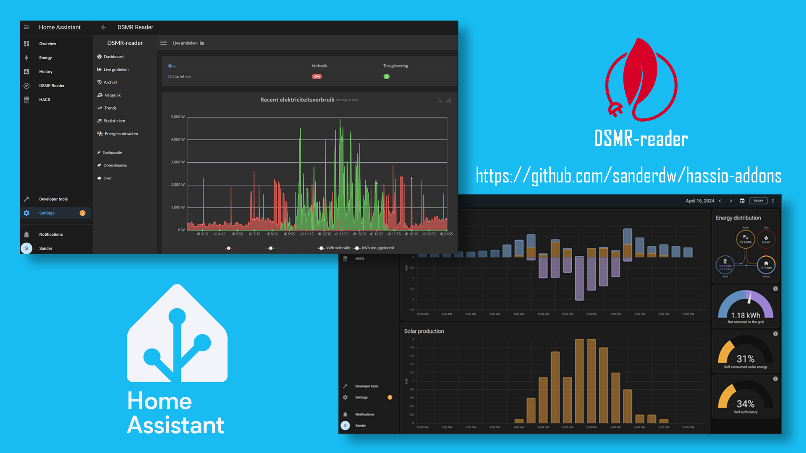

# Home Assistant App: DSMR Reader

[![Community Forum][forum-shield]][forum]

Provide a tool to easily extract, store and visualize data transferred by the DSMR protocol of your smart meter.

Credits to Dennis Siemensma for creating the DSMR Reader software (https://dsmr-reader.readthedocs.io) and Bram van Dartel for creating the underlying container image (https://github.com/xirixiz/dsmr-reader-docker).

 ![dsmr-shield] ![addon-shield] ![aarch64-shield] ![amd64-shield]

## Configure the repository

See config instructions here: https://github.com/sanderdw/hassio-addons

## Documentation

Installing, the options, Ingress auto-login, the run modes and the Home Assistant integration are
in the app's **Documentation** tab ([DOCS.md](DOCS.md)).

[dsmr-shield]: https://img.shields.io/badge/DSMR%20Reader%20Version-%206.2-purple.svg?style=flat-square
[addon-shield]: https://img.shields.io/badge/dynamic/json?url=https%3A%2F%2Fgithub.com%2Fsanderdw%2Fhassio-addons%2Fraw%2Frefs%2Fheads%2Fmain%2Fdsmr_reader%2Fconfig.json&query=version&style=flat-square&label=Addon%20Version

[aarch64-shield]: https://img.shields.io/badge/aarch64-yes-green.svg?style=flat-square
[amd64-shield]: https://img.shields.io/badge/amd64-yes-green.svg?style=flat-square
[forum-shield]: https://img.shields.io/badge/community-forum-brightgreen.svg?style=for-the-badge
[forum]: https://community.home-assistant.io/t/dsmr-reader-app-for-home-assistant/279087
