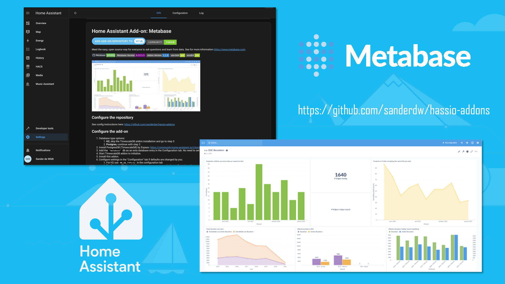

# Home Assistant App: Metabase

[![Community Forum][forum-shield]][forum]

Meet the easy, open source way for everyone to ask questions and learn from data. See for more information https://www.metabase.com.

 ![metabase-shield] ![addon-shield] ![aarch64-shield] ![amd64-shield]

## Documentation

Installing, where Metabase keeps its own data, opening it, adding your data, backups and every
option are in the app's **Documentation** tab ([DOCS.md](DOCS.md)).

[aarch64-shield]: https://img.shields.io/badge/aarch64-yes-green.svg?style=flat-square
[amd64-shield]: https://img.shields.io/badge/amd64-yes-green.svg?style=flat-square
[metabase-shield]: https://img.shields.io/badge/Metabase%20Version-%200.65.5.1-purple.svg?style=flat-square
[addon-shield]: https://img.shields.io/badge/dynamic/json?url=https%3A%2F%2Fgithub.com%2Fsanderdw%2Fhassio-addons%2Fraw%2Frefs%2Fheads%2Fmain%2Fmetabase%2Fconfig.json&query=version&style=flat-square&label=Addon%20Version
[forum-shield]: https://img.shields.io/badge/community-forum-brightgreen.svg?style=for-the-badge
[forum]: https://community.home-assistant.io/t/metabase-add-on-for-home-assistant/286413
